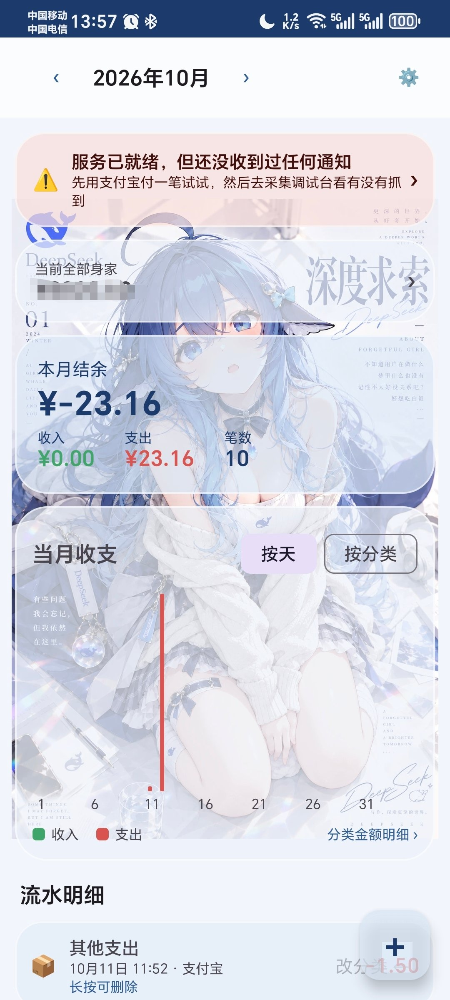
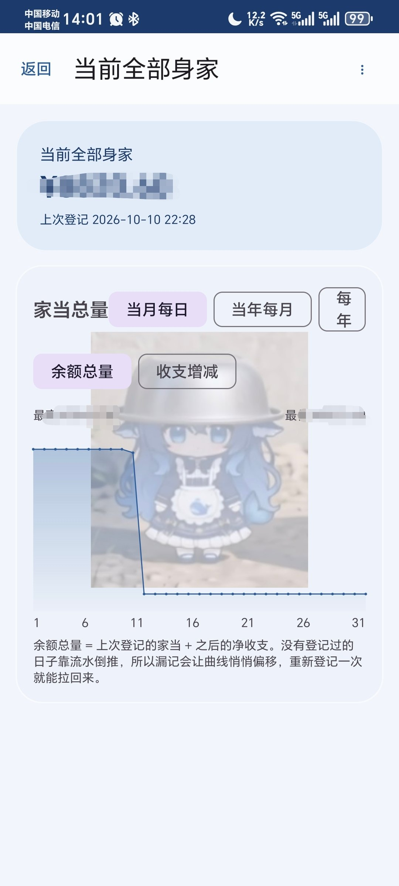
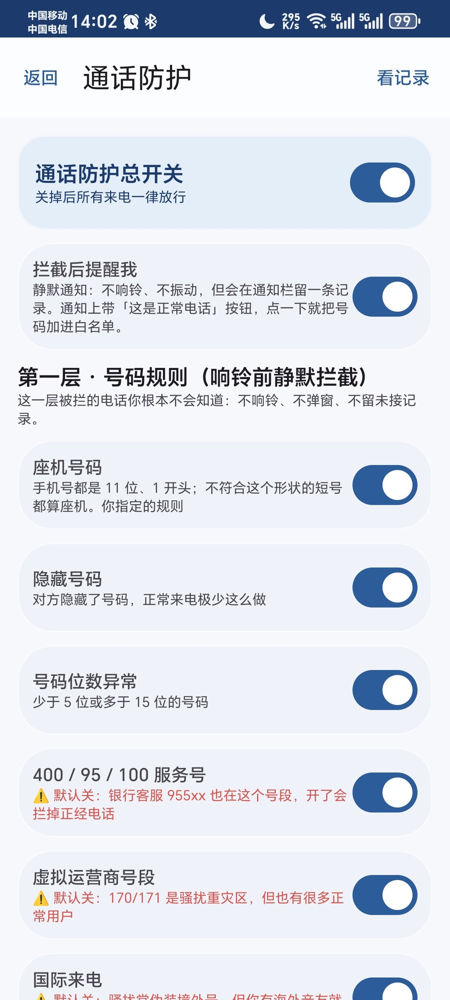
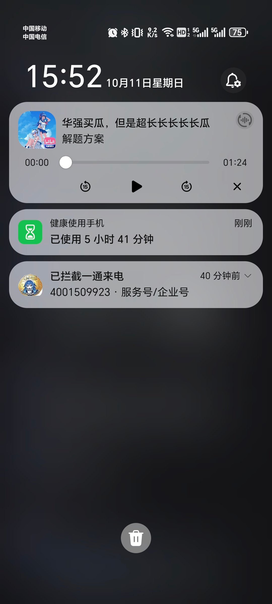
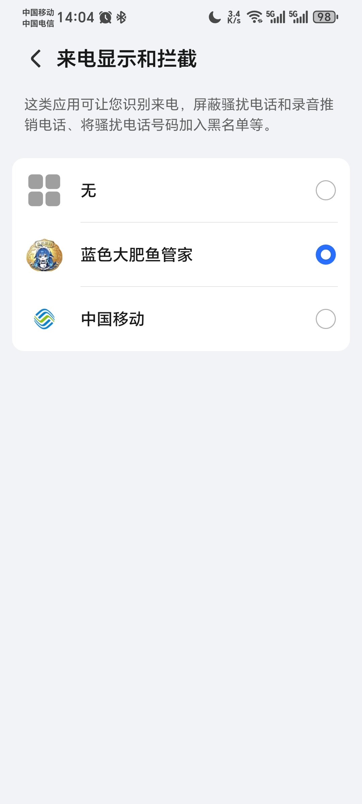

# 蓝色大肥鱼管家 🐳

> 一个**完全本地**的安卓自动记账应用 —— 不用 root，不联网，不上传。
> 账单自动从通知栏和支付结果页里"捡"出来，记完还有只鲸鱼娘跳出来吐槽你。

---

## 📱 下载

<h3 align="center">
  <a href="https://github.com/a2244921700-code/blue-whale-keeper/releases/latest">
    → 点这里下载最新版 APK ←
  </a>
</h3>

<p align="center">
  <sub>需要 Android 8.0 及以上 · arm64-v8a · 那个链接永远指向最新版</sub><br/>
  <sub>装之前记得在系统设置里给「无障碍」和「通知使用权」两个权限</sub>
</p>

---

<p align="center">
  
  
  
  
</p>

---

## 这是什么

市面上自动记账 App 大致三条路：**读短信**（要运营商支持）、**Xposed  hook**（要 root）、**云同步**（要把账单传上去）。

这个走的是第四条：**读通知栏 + 读支付结果页**。

- ✅ **不用 root** —— 纯通知监听 + 无障碍服务
- ✅ **完全离线** —— 没有一行联网代码，账单只存在你自己的 SQLite 里
- ✅ **数据可查** —— 采集到的原始证据、解析过程、为什么没记上，全都摊开给你看

除此之外还兼职做了个**骚扰电话拦截** —— 座机静默挂断，来电名含「传媒」「国学」这类词的也挂。**已在荣耀 80 上实机验证可用**。

---

## 核心功能

### 一、自动记账：四条采集通道

不同 App 的支付信息出现在不同地方，所以做了四条通道互补：

| 通道 | 抓什么 | 适用场景 |
|---|---|---|
| **通知监听** | 通知栏的支付/到账通知 | 微信、支付宝、银行、拼多多先用后付 |
| **无障碍读屏** | 支付结果页的文本节点 | 拿到**商户名**（通知里往往没有） |
| **截图 OCR** | 自绘页面的截图识别 | 微信这类拿不到文本节点的页面 |
| **银行专项** | 银行到账短信/推送 | 只记**收入**，支出交给支付宝微信 |

**为什么要四条**：支付通知常常只有金额没有商户名（"你有一笔32.00元的支出"），而分类恰恰依赖商户名。读屏能补上这一环，两者会**自动融合成一条记录**，不会记两笔。

### 二、自动分类：关键词库 + 可视化规则编辑器

7 个支出大类（餐饮/交通/购物/生活缴费/医疗/娱乐/其他）+ 6 个收入类。分类靠一个**带权重的关键词库**：

- **强信号词**（"餐厅""地铁"）+10 分
- **品牌词**（"瑞幸""沙县"）+8 分
- **品类词**（"咖啡""小吃"）+6 分
- **排除词** —— 一票否决某分类（比如"外卖"会阻止"美团"被归到购物）

**改词库不用更新 App**：设置里改完立刻生效，App 会比对内容哈希自动重新导入。

### 三、当前全部身家

不是简单的"收入减支出"，而是**以你登记的真实余额为锚点**：

```
当前余额 = 上次登记的家当 + 之后的净收支
```

漏记了不用一笔笔补 —— **重新登记一次就把账对齐了**。

登记时如果和账本算出来的数不一致，会弹窗让你**指明这笔差额属于什么类型**，并自动补一条记录。

余额变化曲线支持三个粒度和两个指标：

- 粒度：**当月每日 / 当年每月 / 每年**
- 指标：**余额总量**（我到底有多少钱）/ **收支增减**（这段时间赚了花多少）

### 四、鲸鱼娘反馈：16 种情景 + 配音

记账不是冷冰冰地写一条记录。识别到不同场景会弹出对应的插画和语音：

- 花超过 500 → 「你怎么一下花掉这么多！」
- 17:00 后吃餐饮 → 「你吃你自己的晚饭吧，别抢我的大白饭！」
- **商户名里有"鱼"** → 「你怎么可以吃鱼，再也不理你了！哼！」（优先级最高）
- 收入和金额还有三档：<100 / 100~1000 / ≥1000

反馈规则按**优先级**匹配，冲突时优先级高的赢（所以吃鱼彩蛋能压过餐饮常规图）。

### 五、通话防护（附加功能）

| 层级 | 机制 | 效果 |
|---|---|---|
| **第一层** | `CallScreeningService` + 号码规则 | **响铃前静默拦截**，用户完全无感知 |
| **第二层** | 无障碍读屏 + 关键词 | 来电名含「传媒」「国学」等 → 挂断（会响一两声） |

- 座机规则利用一个事实：**国内手机号都是 11 位、1 开头**
- 通讯录里的号码**永远放行**
- 拦截后留**静默通知**，带「这是正常电话」按钮，点一下加白名单

<p align="center">
  
</p>

> **实机验证**（荣耀 80 / Android 12）：400 开头的服务号被静默拦下，
> 用户全程没被打扰，只在通知栏留下一条记录。
> 这也证明了**国产 ROM 是允许第三方承担来电筛选角色的** ——
> 前提是去「设置 → 应用 → 默认应用 → 来电显示和拦截」里手动授权。

---

## 它是怎么工作的

```
                    ┌─ 通知监听 ─────┐
                    ├─ 无障碍读屏 ───┤
   支付发生 ────────┼─ 截图 OCR ─────┼──→ 原始证据 (raw_evidence)
                    └─ 银行推送 ─────┘         │
                                               ↓
                                        「证据融合」
                                  同金额+同方向+时间窗内 → 合并成一条
                                  商户名互补，不是简单去重
                                               ↓
                                        解析 (Parser)
                                  提取金额 / 方向 / 商户名
                                               ↓
                                       关键词分类器
                                               ↓
                                        交易记录 (transactions)
                                               ↓
                                    鲸鱼娘反馈 + 统计
```

**几个设计上的取舍**：

- **金额一律用整数分**存 —— 浮点数算钱迟早出问题
- **统计永远现算**（SQL 聚合），不存快照 —— 这样改了分类，统计立刻跟着变
- **指纹去重 + 60 秒窗口**：同一笔支付的通知和读屏结果不会记两次；但**商户名不同就不算重复**（每天都吃同一家的同一份饭，金额一样是常态）
- **未来时态不记账**：「将于明日扣款19.9元」是提醒不是交易

---

## 安装使用

### 下载

到 [Releases](../../releases) 下载最新 APK。系统要求 **Android 8.0+**（minSdk 26）。

### 首次配置

装好后进「设置 → 权限与采集」，按体检结果逐项开启。最关键的三项：

| 权限 | 作用 | 不开会怎样 |
|---|---|---|
| **通知使用权** | 抓支付通知 | 完全不工作 |
| **无障碍服务** | 读支付结果页 → 拿商户名 | 所有消费归到「其他」 |
| **悬浮窗** | 弹鲸鱼娘反馈 | 反馈改成通知形式 |

如果要用通话防护，还需要在**系统设置 → 应用 → 默认应用 → 来电显示和拦截**里选择本应用：

<p align="center"></p>

> ⚠️ 国产 ROM 可能不允许第三方应用承担这个角色。**没授予的话第一层拦截一次都不会执行**（第二层读屏挂断仍然可用）。

### 用之前值得知道的三件事

1. **先去「当前全部身家」登记一次真实余额** —— 不登记的话余额从 0 起算，曲线没有意义
2. **抓不到就去「采集调试台」看** —— 它会告诉你 App 到底收到了什么、为什么没记上
3. **规则可以自己改** —— 「分类与识别规则」里加关键词，改完立刻生效

### 调试技巧

设置里的「**解析测试器**」可以直接粘一段通知原文，立刻看到：解析出多少金额、识别成什么商户、归到哪个分类、**会弹哪张反馈图**。

调规则的时候比真花钱测试快得多。

---

## 技术栈

| | |
|---|---|
| 语言 | Kotlin |
| UI | Jetpack Compose + Material 3 |
| 数据库 | Room (SQLite)，9 张表 |
| 异步 | Coroutines + Flow |
| 序列化 | kotlinx.serialization |
| OCR | ML Kit 中文识别（**内置模型，不依赖 Google 服务**） |
| 构建 | Gradle 8.7 + KSP，minSdk 26 / targetSdk 34 |

**体积优化**：素材从 16.3 MB 压到 1.98 MB（WebP q88，GIF 转动态 WebP），配合 R8 + 资源压缩 + arm64 单架构，APK 从 51 MB 降到 17 MB。

---

## 自行构建

```bash
# 需要 JDK 17 和 Android SDK (platform 34, build-tools 34.0.0)
git clone https://github.com/a2244921700-code/blue-whale-keeper.git
cd blue-whale-keeper
./gradlew assembleDebug
```

生成 release 包需要自己准备签名：

```properties
# keystore.properties（已在 .gitignore 里，不会上传）
storeFile=your.jks
storePassword=******
keyAlias=******
keyPassword=******
```

---

## 常见问题

**Q：为什么不读短信？**
A：读短信需要 `READ_SMS`，在国内应用商店基本过不了审，而且通知通道已经能覆盖绝大多数场景。银行到账通知同样走通知监听。

**Q：为什么美团外卖算餐饮而不是购物？**
A：购物词库里有「外卖」这个**排除词**。这是刻意的 —— 关键词库支持一票否决，专门用来处理这种"品牌名指向一个品类、实际消费属于另一个"的情况。

**Q：记重复了怎么办？**
A：流水条目**长按**弹删除确认（短按是确认这笔，两个操作刻意分开，避免误触）。

**Q：为什么有些消费归到「其他」？**
A：多半是没开无障碍服务 —— 通知里通常只有金额没有商户名，拿不到商户名就没法分类。

---

## 隐私

- **没有网络权限** —— 不是"承诺不上传"，是 App 根本没有联网的能力
- 所有数据存在应用私有的 SQLite 里，卸载即清除
- 采集到的原始证据（通知原文）也留在本地，可在「采集调试台」里查看和清空
- 截图 OCR 全程在设备上完成，图片不落盘

---

## 踩坑记录

这个项目的规则**几乎全部来自真机测试中踩到的坑**，而不是坐在电脑前推演出来的。
挑几个最有代表性的记在这里 —— 它们比功能列表更能说明这个项目是怎么长出来的。

### 金额提取：「[48条]」被当成了 48 元

```
微信支付 | [48条]微信支付：已支付¥4.85
                    ↑
            这单被记成了 48 元
```

通用句式正则是「动作词 + 最多 10 个非数字字符 + 数字」，
而 `[48条]` 的方括号不在排除字符里 —— 从「支付」到「48」刚好只夹了 ` | ` 三个字符。

**修法**：不再猜"动作词附近的数字"，改成**按来源认货币锚点**
（微信认 `¥`、支付宝认「元」、银行认「人民币」）。
银行那条尤其重要：卡号、余额都可能长成 `1234元`，只有「人民币」不会。

### 付款码被扫采不到：判定顺序写反了

原逻辑是「先排除浏览页，再看成功标记」，而 `BROWSING_MARKERS` 里写着
**「交易单号」「商户单号」**——**支付成功页上恰好也有这些**（订单详情的一部分）。
于是真实的支付成功页被一票否决。

**修法**：成功标记优先。同时补上了「**已支付**」这个词——
微信付款码被扫之后显示的就是它。

### 转账、红包判不出方向

「转账」「红包」**本身没有方向**：

```
「转账给张三」= 支出      「张三向我转账」= 收入
「发出红包」  = 支出      「收到红包」    = 收入
```

只看词必然判错一半。**修法**：按短语判断，且**收入短语必须先查**——
否则「张三向我转账」会被 `向…转账` 抢走，记成一笔假支出。

### 「支付宝」里藏着「支付」

品牌名本身就含动作词：

```
「支付宝」  → 含「支付」  → 命中支出词表
「微信支付」→ 含「支付」
```

于是「支付宝 | 20.00元」这种只有金额、没有方向的通知会被**瞎猜成支出**——
而它完全可能是退款到账。

**修法**：判方向前先洗掉品牌名，判不出来就**安全放弃**。
**错账比漏账难发现得多。**

### 下拉通知栏会触发读屏

无障碍事件的 `packageName` 表示「**这个事件和谁有关**」，**不是**「谁在前台」。
通知栏里有微信消息时，事件包名是微信，但屏幕上显示的是 SystemUI ——
于是读屏读回来一堆「WLAN 信号强度满格」「电量剩余 74」。

**修法**：加「前台闸门」，用 `rootInActiveWindow.packageName` 和事件包名对一下。
**顺带省掉了大量无谓的节点树遍历。**

### 每天都吃同一家的同一份饭

去重原本只比对「金额 + 方向」，导致第二笔同金额消费被当成重复吞掉。
但**同金额消费是常态**——同一家店、同一份饭，金额当然一样。

**修法**：加入商户名判断。两边都有名字且不同 → 不是重复。
时间窗也从 120 秒收紧到 60 秒。

### 微信支付：认页面，而不是猜文案

最初的做法是枚举成功文案（「支付成功」「已支付」「付款成功」…），
但这是个**永远列不全的集合**：微信改一次版就可能失效。

后来意识到：微信的支付入口五花八门（付款码 / 扫码 / 小程序 / 游戏内购 / 公众号），
但它们**全都会收敛到同一个支付完成页**。
于是改为**认这个页面本身**——类名优先，结构兜底
（「金额 + 收款方」同时出现，因为用户想知道"付了多少钱给谁"，页面就必须给出这两样）。

### 静默拦截必须可撤销

骚扰电话被静默拦掉（不响铃、不弹窗、不留未接记录）——**万一误杀，用户永远不知道**。

**修法**：拦截后留一条**低优先级通知**（不响铃不振动，只躺在通知栏），
带一个「这是正常电话」按钮，点一下加进白名单。
**没有这一步，静默拦截就是个危险功能。**

---

## 相关文档

- [更新日志](CHANGELOG.md)
- [设计方案](docs/设计方案.md) —— 功能边界与技术选型的推导过程
- [需求规格](docs/需求规格.md) —— 需求冻结版本

---

## 开源协议

[自定义开源许可](LICENSE)（基于 MIT，附「禁止原样转售」条款）——

- ✅ **随便用、随便改、随便分发**，改了也不用告诉我
- ✅ **基于它开发的新软件可以收费**（加了实质功能就算衍生作品，定价、闭源都随你）
- ❌ **但不能把原样的副本拿去卖**（上架应用商店收费、打包进付费产品、收费提供下载等）

要是你做出了好用的功能，欢迎提 PR。

---

## 开发者

**浪染霞 · 浪のDeepseek Harness**

### 素材来源

- **形象与人格化反馈文案**：源于社区，**并非原创**，但版权归属于**杭州深度求索人工智能基础技术研究有限公司**
- **配音**：取自 [fish.audio](https://fish.audio/zh-CN/app/u/7941628892334ddf8eb1e047ee158c81/) 上的「蓝色大肥鱼」AI 声音，再通过 fish.audio 合成生成。
- **名字**：来自 DeepSeek 网友对它的昵称"蓝色大肥鱼" 🐳
